<!-- Header wave is decorative only; name and title are real text below so they are indexed. -->

  

<h1 align="center">Rasika Liyanaarachchi</h1>
<h3 align="center">System Operations Engineer</h3>

  <b>Linux · Cloud Infrastructure · Kubernetes · CI/CD · Observability · Security · DFIR</b>

  

## 👋 About Me

I'm a **System Operations Engineer** who keeps production secure, observable, and predictable. My work spans the full operational lifecycle: **CI/CD pipelines and infrastructure as code, cloud and container platforms, monitoring and on-call, through to incident response and digital forensics (DFIR).**

I approach every system security-first, with **defense in depth, least privilege, hardened defaults, and audit-ready practices** built in from day one. Beyond core operations, I have a strong interest in web performance and SEO. I'm also known online under a few pseudonyms.

> **Automate the toil. Harden the defaults. Keep production boring.**

- 🎯 **How I work:** automate it → monitor it → secure it → document it
- 💬 **Ask me about:** Linux internals, Kubernetes, observability stacks, incident response
- 🔍 **Specialties:** DFIR, malware removal and website recovery, performance tuning

  

## 🛠️ What I Do

### ⚙️ CI/CD & Release Engineering
- Designing clean, maintainable CI/CD pipelines
- Automating code deployments end to end
- Improving release velocity without trading off safety
- Reducing deployment risk with progressive, gated releases
- Managing versioning and fast, tested rollbacks
- Managing consistent environments across dev, staging and prod

### ☁️ Cloud & Infrastructure
- Managing cloud infrastructure across AWS, GCP, OCI, DigitalOcean, Alibaba Cloud and Tencent Cloud
- Building infrastructure as code
- Designing scalable, resilient architectures
- Capacity planning and resource optimization
- Cost optimization across cloud services

### 📈 Reliability & Observability
- Monitoring logs, metrics and alerts
- Ensuring system reliability and uptime
- Troubleshooting production issues under pressure
- Handling incident response and on-call rotations
- Automating repetitive operational tasks

### 🛡️ Security & Compliance
- Maintaining security best practices and hardened baselines
- Managing secrets and access control
- Network and infrastructure security
- Vulnerability management: identify, protect, detect, respond, recover
- Digital forensics and incident response (DFIR)

### 🐳 Platforms & Servers
- Managing containers and orchestrators (Docker, Kubernetes)
- Linux and Windows server administration
- Database administration: PostgreSQL, MariaDB/MySQL, MongoDB, Redis
- Enterprise mail servers, VoIP servers and devices

### 🤝 Collaboration & Web
- Partnering with Dev, QA and Architecture teams on fixes
- Performance optimization across the stack
- Malware removal and website recovery
- Web development and SEO optimization

## 🧰 Tech Stack

  

| Domain | Technologies |
|:--|:--|
| ☁️ **Cloud** | AWS · Google Cloud (GCP) · Oracle Cloud (OCI) · DigitalOcean · Alibaba Cloud · Tencent Cloud · Cloudflare |
| 🐧 **Operating Systems** | Linux (Oracle Linux, RHEL, Ubuntu, Debian) · Windows Server · Raspberry Pi |
| 🌐 **Web Servers** | Nginx · Apache |
| 🐳 **Containers & Orchestration** | Docker · Kubernetes · k3s · Harbor |
| 🔁 **CI/CD & Automation** | GitLab CI · Jenkins · GitHub Actions · Argo CD · Git · Bash · Python |
| 🏗️ **IaC & Secrets** | Terraform · Ansible · HashiCorp Vault |
| 📈 **Observability** | Grafana · Prometheus · VictoriaMetrics · Loki · Zabbix · Elasticsearch |
| 🗄️ **Databases** | PostgreSQL · MariaDB · MySQL · MongoDB · Redis |
| 🛡️ **Vulnerability Scanning & DAST** | Nessus · Acunetix · Burp Suite · ZAP (Zed Attack Proxy) |
| 🎯 **Penetration Testing** | Nmap · Metasploit |
| ☸️ **Container, IaC & Kubernetes Security** | Trivy · Checkov · KubeLinter · kube-bench |
| 🔒 **Secure Access & Network Analysis** | WireGuard · OpenVPN · Wireshark |
| 🧪 **API Testing & Debugging** | Postman |

## 🎮 Off the Clock

- 🐧 Deep-diving into advanced Linux internals
- 🕵️ Practicing SOC analysis and threat hunting
- 🧪 Testing FOSS software and scripts
- 🕹️ Hosting game servers

  

